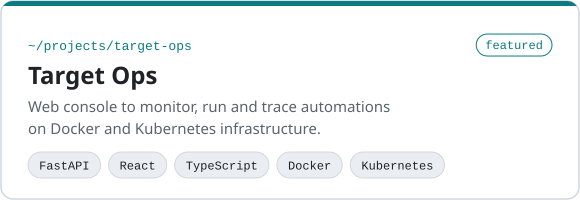
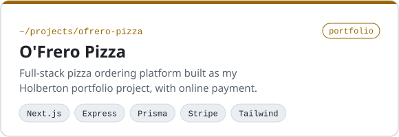
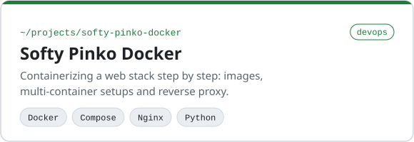
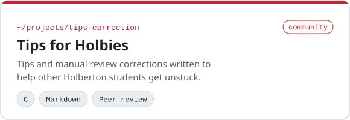
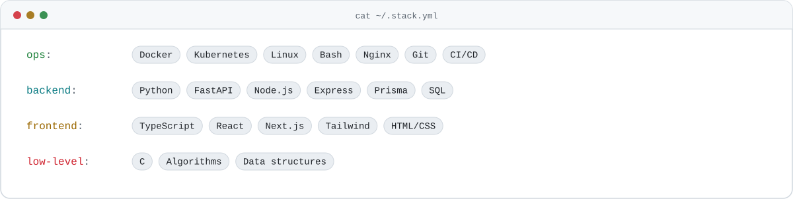

<picture>
  <source media="(prefers-color-scheme: dark)" srcset="assets/banner-dark.svg">
  <source media="(prefers-color-scheme: light)" srcset="assets/banner-light.svg">
  
</picture>

<br>

I am a student at **Holberton School Toulouse**, working my way from full-stack foundations toward **DevOps engineering**: containers, orchestration, automation and the pipelines that ship it all. I like building tools that make infrastructure visible and boring in the good sense.

```yaml
name: Sofian
role: DevOps engineer in progress
school: Holberton School, Toulouse
focus: [containers, kubernetes, ci-cd, linux, automation]
building: Target Ops, a console for Docker and Kubernetes automations
```

## Selected work

<p>
  <a href="https://github.com/smessaoui31/target-ops">
    <picture>
      <source media="(prefers-color-scheme: dark)" srcset="assets/card-target-ops-dark.svg">
      
    </picture></a><a href="https://github.com/smessaoui31/Portfolio-Project">
    <picture>
      <source media="(prefers-color-scheme: dark)" srcset="assets/card-ofrero-pizza-dark.svg">
      
    </picture></a><a href="https://github.com/smessaoui31/holbertonschool-softy-pinko-docker">
    <picture>
      <source media="(prefers-color-scheme: dark)" srcset="assets/card-softy-pinko-docker-dark.svg">
      
    </picture></a><a href="https://github.com/smessaoui31/Tips-Correction-holbies">
    <picture>
      <source media="(prefers-color-scheme: dark)" srcset="assets/card-tips-correction-dark.svg">
      
    </picture>
  </a>
</p>

<!--
  DEMO VIDEO
  1. On github.com, open this README in the web editor (pencil icon).
  2. Remove the comment markers around the Demo block below (keep this note or delete it).
  3. Delete the line VIDEO_URL_HERE, then drag your .mp4 or .mov onto that empty line:
     GitHub uploads it and inserts a https://github.com/user-attachments/assets/... link,
     which renders as a video player on its own line.
  4. Adjust the caption, then commit.
-->

## Demo

[VIDEO_URL_HERE
](https://github.com/smessaoui31/smessaoui31/blob/main/assets/target-ops-v1.mp4)
<p align="center"><sub><a href="https://github.com/smessaoui31/target-ops">Target Ops</a> - a 45-second walkthrough of the console</sub></p>

## Stack

<picture>
  <source media="(prefers-color-scheme: dark)" srcset="assets/stack-dark.svg">
  
</picture>

## Right now

- Growing **Target Ops** from a simulated prototype toward real clusters
- Going deeper on Kubernetes, observability and CI/CD pipelines
- Sharing what I learn with other Holberton students

<br>

<picture>
  <source media="(prefers-color-scheme: dark)" srcset="assets/footer-dark.svg">
  
</picture>
